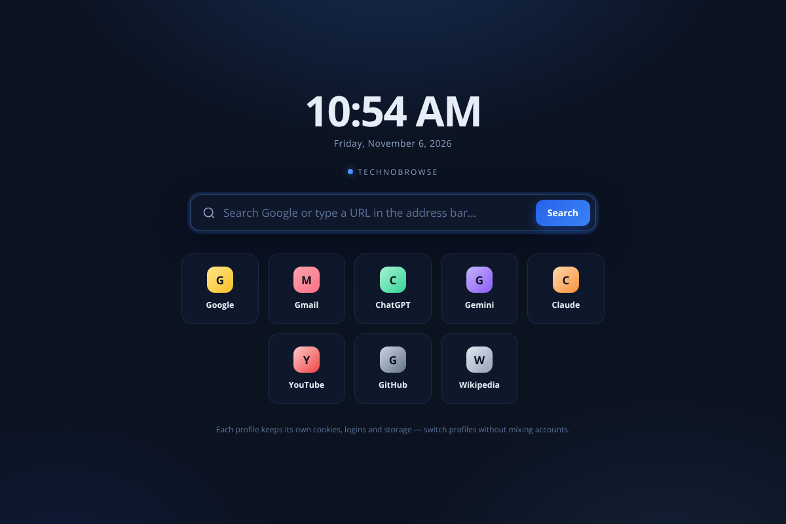

# TechnoBrowse


**TechnoBrowse is a lightweight desktop browser where every profile is a completely isolated, persistent browser environment.** Log into ChatGPT with one account in one profile, another account in a second profile, Gmail in a third — they never share cookies, sessions, cached files, or storage.

- **No Gmail auth wall** — profiles are created instantly with just a name. Authentication happens only inside the profile windows, manually, by you.
- **True isolation** — each profile gets its own persistent Chromium session via `session.fromPartition('persist:profile-<id>')`.
- **Persistent** — logins survive window closes, app restarts, and portable-app updates.
- **Local-only** — `profiles.json` (metadata) plus Chromium partition directories. No telemetry, no sync, no passwords ever stored.

---

## Quick start (development)

Requirements: **Node.js 20+** (22 LTS recommended) and npm. For the real desktop app you also need the Electron binary, which `npm install` fetches automatically from the Electron release servers.

```bash
npm install
npm run dev     # Vite dev server + Electron with hot reload
```

Or run a production build locally:

```bash
npm start       # vite build + electron .
```

> Note on sandboxes/offline environments: if the Electron binary cannot be
> downloaded (GitHub release assets are required), the renderer still builds and
> all logic tests run — see **Verification** below.

### Scripts

| Command | What it does |
|---|---|
| `npm run dev` | Start Vite + Electron for development |
| `npm run build` | Build the dashboard + browser-chrome bundles into `dist/` |
| `npm start` | Production build, then launch the app |
| `npm test` | Unit tests (profile store, URL normalization) — plain node |
| `npm run smoke` | Integration smoke test of the Electron main process with a stubbed `electron` module — verifies per-profile partitions, IPC, deletion wiping |
| `npm run render-check` | Server-renders both React entries to catch render-time crashes |
| `npm run dom-check` | Drives the dashboard UI with jsdom — create/validate/delete flow end-to-end |
| `npm run dom-check:chrome` | Drives the toolbar UI with a mocked Electron bridge — navigation, buttons, loading state |
| `npm run check` | Runs every check above plus a production build |
| `npm run dist` | **Build the Windows x64 portable executable** into `release/` |
| `npm run dist:dir` | Build an unpacked Windows app directory (faster, for debugging) |

---

## Building the Windows portable executable

On a Windows 10/11 x64 machine (or CI — see below):

```powershell
git clone <your fork> TechnoBrowse
cd TechnoBrowse
npm install          # downloads the Electron binary
npm run dist
```

Output: **`release/TechnoBrowse-1.0.0-Portable-x64.exe`**

- No installation required — double-click and run.
- Fully **portable**: copy it to a USB drive or `D:\MyTools\` and it works, with all profile data traveling alongside it.
- **Data location in portable mode:** the folder containing the `.exe` is used —
  `profiles.json` (metadata) and `user-data/Partitions/profile-<id>/` (Chromium storage) live next to the executable. Replacing the `.exe` with a newer build keeps all profiles and logins intact.
- **Fallback:** if that folder is not writable (e.g. `C:\Program Files`), TechnoBrowse automatically uses `%APPDATA%\TechnoBrowse\` instead. The data folder is chosen once at startup by probing writability — it is never silently relocated afterward.
- The portable build requests the `user` execution level — **no admin rights needed**.

### CI alternative

`.github/workflows/windows-portable.yml` builds and runs the full test suite on every push/dispatch and uploads the portable `.exe` as a build artifact — handy if you don't have a Windows machine handy. Trigger it from the **Actions** tab.

### Windows SmartScreen note

The executable is unsigned (code-signing certificates are intentionally out of scope). On first run, SmartScreen may warn — click **More info → Run anyway**. For distribution, consider an Authenticode certificate and `win.certificateFile` in `electron-builder.yml`.

---

## How profile isolation works

| Profile | Session partition | On-disk storage |
|---|---|---|
| #1 `Work` | `persist:profile-9f3a…` | `user-data/Partitions/profile-9f3a…/` |
| #2 `Personal` | `persist:profile-1c2d…` | `user-data/Partitions/profile-1c2d…/` |
| #3 `Client` | `persist:profile-8e7b…` | `user-data/Partitions/profile-8e7b…/` |

- Each profile's `WebContentsView` (the invisible page container) is created with `webPreferences.session = session.fromPartition('persist:profile-<id>')` — never the default session, never another profile's session.
- OAuth popups (`window.open`) are re-created as bare `BrowserWindow`s **in the same profile partition**, so Google/Microsoft sign-in flows work and their cookies land in the right profile.
- Closing a profile window never clears anything. Data is removed **only** when you explicitly delete a profile: the app then closes that profile's windows, removes its metadata, calls `session.clearStorageData()/clearCache()/clearAuthCache()`, and deletes the `Partitions/profile-<id>` directory. Other profiles are untouched.
- `profiles.json` contains **only** metadata: `id`, `name`, optional `email` label, avatar color, timestamps. No cookies, tokens, or passwords — ever.

### Data layout

```
<data root>/                     ← portable folder, or %APPDATA%\TechnoBrowse
├── profiles.json                ← metadata only (atomic writes, corrupt-file backup)
└── user-data/
    └── Partitions/
        ├── profile-9f3a…/       ← cookies, local/session storage, IndexedDB, cache
        ├── profile-1c2d…/
        └── profile-8e7b…/
```

The data root is resolved **before** any session is created (`electron/paths.js`), with a writability probe and graceful fallback to `%APPDATA%`.

---

## Using the app


**Dashboard**
- `+ Create New Profile` → enter a name (required) and an optional email label → **Create Profile**. Done. No sign-in.
- Each card shows the avatar, name, email label, created/last-opened dates, the raw partition name (with copy button), and **Open Profile** / edit / delete actions.
- **Open Profile** launches a dedicated browser window. Clicking it again focuses the existing window instead of duplicating it. Multiple profiles run side by side happily.

**Inside a profile window**
- Back / Forward / Reload / Home, an address bar (Enter to navigate, `Ctrl+L` to focus), loading indicator, and your current page title in the window bar.
- Typing `example.com` navigates; typing free text searches Google.
- The profile chip in the toolbar shows which isolated profile you're in.
- **Home** opens the built-in TechnoBrowse start page (clock, Google search, quick tiles) — it works offline.
- F12 / Ctrl+Shift+I toggles DevTools for the page.
- Log into Gmail, ChatGPT, Gemini, Claude, GitHub… manually. Credentials never touch the app — they're typed into the website, inside that profile's isolated storage.



---

## Architecture

```
TechnoBrowse/
├── electron/                  ← main process (CommonJS)
│   ├── main.js                ← app lifecycle, BrowserWindows, WebContentsViews, IPC, session wipe
│   ├── paths.js               ← data-root resolution (portable-aware), set BEFORE any session exists
│   ├── profileStore.js        ← atomic, corruption-tolerant profiles.json CRUD (no Electron imports)
│   ├── urlUtils.js            ← address-bar normalization & scheme allow/block lists
│   ├── preload.js             ← dashboard bridge (contextBridge; narrow API surface)
│   └── chromePreload.js       ← toolbar bridge
├── src/                       ← React 19 (JavaScript, not TypeScript)
│   ├── App.jsx                ← dashboard
│   ├── components/            ← ProfileCard, ProfileFormModal, DeleteProfileModal, Toasts
│   ├── browser/               ← browser chrome (toolbar) for profile windows
│   └── lib/profileUtils.js
├── public/start.html          ← built-in start page (loaded as file:// inside each profile)
├── index.html / browser.html  ← Vite multi-page entries
├── scripts/
│   ├── dev.mjs                ← Vite + Electron dev launcher
│   ├── test-store.mjs         ← unit tests (profileStore + urlUtils)
│   ├── smoke-main.cjs         ← main-process integration tests with a stubbed electron module
│   ├── render-check.mjs       ← SSR render smoke check for both React entries
│   ├── dom-check.mjs          ← jsdom end-to-end flow for the dashboard (create/edit/delete)
│   └── dom-check-chrome.mjs   ← jsdom toolbar flow with a mocked Electron bridge
├── build/icon.png             ← app icon (1024×1024)
├── electron-builder.yml       ← Windows x64 portable target
└── .github/workflows/windows-portable.yml
```

**Renderer ↔ main IPC is explicit and narrow.** The dashboard sees only `listProfiles/createProfile/updateProfile/deleteProfile/openProfile/getAppInfo/openDataRoot/onProfilesChanged`. The toolbar sees only `ready/navigate/back/forward/reload/home/toggleDevTools/setToolbarHeight/onState/onToast/onCrashed`. No cookies, sessions, or Node APIs are exposed to either UI, and sandboxing + context isolation are on everywhere.

**Navigation policy**
- Profile views only load `http:`, `https:`, or the built-in `technobrowse://start` page; every other scheme is blocked (`will-navigate`).
- `<webview>` attachment is denied app-wide.
- `window.open`/OAuth popups are re-created inside the same profile partition; only `http(s)` may open.
- The dashboard and chrome windows never navigate to the web at all.
- Dangerous permissions (USB, serial, HID, Bluetooth, MIDI sysex) are denied; everything else behaves like a normal browser.

---

## Manual verification matrix (run on Windows — Tests 1–5 from the spec)

> The sandbox this repo was assembled in cannot display Electron windows, so these five scenarios are **scripted for you to run on a real machine** (or the Actions artifact). Everything scriptable *without* a display is covered above (`npm test`, `npm run smoke`).

1. **Session isolation** — Create A and B. Open A → `https://www.google.com` → log into any account. Open B → same site → you must be **logged out**. ✔ If you see the account from A, isolation is broken — report it.
2. **Session persistence** — Log into any site in A. Close A's window. Reopen A. You should still be logged in. (Partition is reused; nothing is reset.)
3. **Multiple simultaneous profiles** — Open A, B and C; log into three different accounts of the same site; confirm all three stay independent after closing and reopening.
4. **Application restart** — Log into several sites across profiles. Quit TechnoBrowse completely. Start it again. Profiles and all sessions must be intact.
5. **Profile deletion** — Delete one profile. Its window closes; `profiles.json` loses only that entry; `user-data/Partitions/profile-<id>/` is removed; other profiles' logins are unaffected. (Delete is irreversible and the UI warns before it happens.)

---

## Verification status

| Check | Result |
|---|---|
| `npm run build` (Vite, dashboard + chrome) | ✅ passing |
| `npm test` — profile store, URL utils | ✅ 17/17 |
| `npm run smoke` — main-process IPC/partitions/deletion | ✅ 9/9 |
| `npm run render-check` — both React entries render | ✅ 2/2 |
| `npm run dom-check` — dashboard create/edit/delete flow | ✅ 9/9 |
| `npm run dom-check:chrome` — toolbar navigation flow | ✅ 9/9 |
| Visual QA (`scripts/visual-check.mjs`, headless Chromium screenshots of dashboard, modals, toolbar, start page) | ✅ see `docs/screenshots/` |
| `electron-builder --linux dir` in this sandbox | ❌ blocked — the Electron binary host (GitHub release assets) is unreachable from here |
| Live GUI run / portable `.exe` build | ⚠️ must be run once on a normal network — `npm install && npm run dist` |
| Manual Tests 1–5 (isolation, persistence, restart, deletion) | ⚠️ run on Windows before release |

`npm run preview` (or `npx vite preview`) serves the built app on port 4173 — in a normal browser the dashboard runs in a sandboxed **preview/demo mode** (profile actions are simulated); the real isolated sessions exist only inside the Electron app.

## Troubleshooting

- **Blank/black profile window** — run `F12` in the profile window; check the console. Most often an outbound connection issue, not the app.
- **Portable app says the data folder is read-only** — move the `.exe` to a writable folder; TechnoBrowse then uses `%APPDATA%\TechnoBrowse` as data root instead.
- **A fix needed after weird disk cleanup** — if `profiles.json` is ever corrupt, the app backs it up (`profiles.json.corrupt-<ts>.bak`) and starts with an empty list rather than crashing; Chromium partitions are not affected.
- **Delete fails midway on Windows** — files may be locked by antivirus; the app retries removal, and `clearStorageData()` already emptied the profile's cookies/storage regardless.

## License

MIT — see [LICENSE](./LICENSE).
