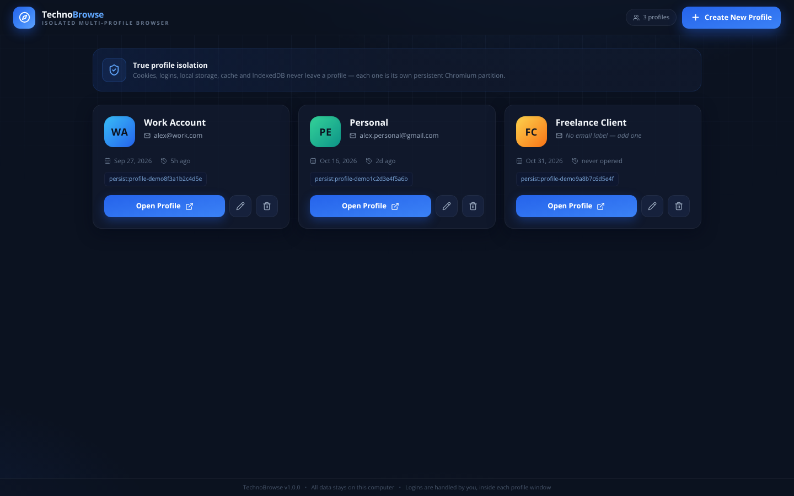
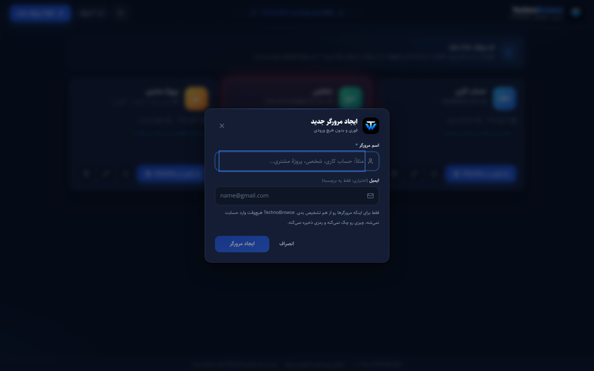

# TechnoBrowse



**TechnoBrowse is a lightweight desktop profile manager for Google Chrome.** It creates, organizes, and launches completely independent Chrome profiles — one profile, one dedicated Chrome `user-data-dir`, zero shared state. Log into ChatGPT with one account in one profile, another account in a second profile, Gmail in a third; they never share cookies, sessions, cached files, or storage.

TechnoBrowse does **not** browse the web itself. Google Chrome renders every page, runs the JavaScript, and owns every session and credential. The result: Google sign-in works (Chrome is a first-class browser, not an embedded one), pages behave exactly as in desktop Chrome, and TechnoBrowse stays tiny.

- **Chrome does the browsing** — authentication, cookies, localStorage, IndexedDB, sessions, cache, downloads, extensions-grade security model: all Chrome.
- **True isolation** — every profile gets its own directory, launched with `chrome.exe --user-data-dir=<dir>`. No two profiles ever point at the same directory.
- **No Gmail auth wall** — profiles are created instantly with just a name. You log in manually, inside Chrome, by yourself.
- **Persistent** — logins survive window closes, app restarts, and portable-app updates.
- **Local-only** — `profiles.json` (metadata) plus the profile directories. No telemetry, no sync, no passwords ever stored or read.
- **AI usage-limit tracker** — one tap per profile card marks the exact moment an AI service limit is reached; the card glows red and shows elapsed hours:minutes (auto-updating), persisted across restarts until you reset it.
- **Floating Technowin promo** — every 5 minutes a sleek banner sweeps across the window (Technowin brand + Instagram/YouTube/Telegram/X), then disappears completely until the next cycle; fixed-position, pointer-transparent, reduced-motion aware.
- **Dark & light themes** — toggle from the header in one click; the choice is remembered.

**Requirement:** Google Chrome must be installed on the machine. TechnoBrowse detects it automatically (Program Files / LOCALAPPDATA, then the Windows registry) and tells you clearly if it is missing — it never falls back to a hidden embedded browser.

---

## Quick start (development)

Requirements: **Node.js 20+** (22 LTS recommended) and npm.

```bash
npm install
npm run dev     # Vite dev server + Electron with hot reload
```

Or run a production build locally:

```bash
npm start       # vite build + electron .
```

### Scripts

| Command | What it does |
|---|---|
| `npm run dev` | Start Vite + Electron for development |
| `npm run build` | Build the dashboard bundle into `dist/` |
| `npm start` | Production build, then launch the app |
| `npm test` | Unit tests (profile store, Chrome detection helpers) — plain node |
| `npm run smoke` | Main-process integration tests with a stubbed `electron` + recorded `spawn()` — verifies per-profile launch args, running-state tracking, deletion refusal, missing-Chrome handling |
| `npm run render-check` | Server-renders the React dashboard to catch render-time crashes |
| `npm run dom-check` | Drives the dashboard UI with jsdom — create/validate/delete flow end-to-end |
| `npm run check` | Runs every check above plus a production build |
| `npm run preview` | Serve the production build on port 4173 (demo mode in plain browsers) |
| `npm run visual-check` | Screenshot the dashboard with headless Chromium (needs `npm run preview` running) |
| `npm run dist` | **Build the Windows x64 portable executable** into `release/` |
| `npm run dist:dir` | Build an unpacked Windows app directory (faster, for debugging) |

---

## Building the Windows portable executable

On a Windows 10/11 x64 machine (or CI — see below):

```powershell
git clone <your fork> TechnoBrowse
cd TechnoBrowse
npm install          # downloads the Electron binary
npm run dist
```

Output: **`release/TechnoBrowse-2.0.0-Portable-x64.exe`**

- No installation required — double-click and run.
- Fully **portable**: copy it to a USB drive or `D:\MyTools\` and it works, with all profile data traveling alongside it.
- **Data location in portable mode:** the folder containing the `.exe` is used — `profiles.json` (metadata) and `profiles/profile-<id>/` (each profile's Chrome user-data directory) live next to the executable. Replacing the `.exe` with a newer build keeps all profiles and logins intact.
- **Fallback:** if that folder is not writable (e.g. `C:\Program Files`), TechnoBrowse automatically uses `%APPDATA%\TechnoBrowse\` instead. The data root is chosen once at startup by probing writability — it is never silently relocated afterward.
- The portable build requests the `user` execution level — **no admin rights needed**.

### CI alternative

`.github/workflows/windows-portable.yml` runs the full check suite on every push/dispatch and, on tagged/manual runs, builds and uploads the portable `.exe` as a build artifact. Trigger it from the **Actions** tab.

### Windows SmartScreen note

The executable is unsigned (code-signing certificates are intentionally out of scope). On first run, SmartScreen may warn — click **More info → Run anyway**. For distribution, consider an Authenticode certificate and `win.certificateFile` in `electron-builder.yml`.

---

## How it works

| Profile | Data directory | Launched as |
|---|---|---|
| #1 `Work` | `profiles/profile-9f3a…/` | `chrome.exe --user-data-dir=…\profiles\profile-9f3a… --new-window` |
| #2 `Personal` | `profiles/profile-1c2d…/` | `chrome.exe --user-data-dir=…\profiles\profile-1c2d… --new-window` |
| #3 `Client` | `profiles/profile-8e7b…/` | `chrome.exe --user-data-dir=…\profiles\profile-8e7b… --new-window` |

- **Launch** — TechnoBrowse finds the installed Google Chrome (see detection below) and spawns it with the selected profile's dedicated directory. Arguments are passed as an **array** to `child_process.spawn` with `shell: false` — no command-line string is ever constructed.
- **Chrome detection** — `TECHNOBROWSE_CHROME_PATH` env var wins; otherwise well-known locations (`%ProgramFiles%`, `%ProgramFiles(x86)%`, `%LOCALAPPDATA%`); otherwise the Windows registry `App Paths\chrome.exe` (the same lookup `start chrome` uses), then the `WOW6432Node` `InstallLocation`. Existence is always verified on disk. Not found? A clear amber banner explains the requirement with a button to the official download page and a **re-check** button. Nothing is installed automatically and no other engine is used.
- **Already running?** — If TechnoBrowse itself launched Chrome for a profile and that process is still alive, clicking Open does **not** spawn a second Chrome against the same directory; you get a toast and the existing window is the one to use. If a profile was launched outside the app (a `SingletonLock` is present), spawning is still safe — Chrome forwards the call to the existing instance and just opens a new window there; it never initializes one data directory twice.
- **Deleting a profile** — refused while that profile's Chrome is running (checked via the process table and the `SingletonLock`). Otherwise the app removes ONLY that profile's metadata from `profiles.json` and deletes ONLY that profile's `profiles/profile-<id>/` directory — cookies, sessions, tokens, cache, preferences and all. Other profiles are untouched.
- `profiles.json` contains **only** metadata: `id`, `name`, optional `email` label, avatar color, timestamps, the relative `directory`, and the optional `aiLimitReachedAt` epoch-ms marker. No cookies, tokens, or passwords — ever. Chrome never gives them to TechnoBrowse, and TechnoBrowse never reads them.

### Data layout

```
<data root>/                     ← portable folder, or %APPDATA%\TechnoBrowse
├── profiles.json                ← metadata only (atomic writes, corrupt-file backup)
└── profiles/
    ├── profile-9f3a…/           ← Chrome user-data-dir: cookies, sessions, IndexedDB, cache, prefs
    ├── profile-1c2d…/
    └── profile-8e7b…/
```

The data root is resolved **before** anything is stored (`electron/paths.js`), with a writability probe and graceful fallback to `%APPDATA%`.

### Migrating from the pre-2.0 embedded browser

Profiles from older (Electron embedded browser) builds are kept: their metadata is read, and each is assigned its canonical `profiles/profile-<id>/` directory automatically on first launch. **Website logins do not carry over** — cookies and sessions from the old Chromium partitions cannot be moved into Chrome, and TechnoBrowse deliberately never migrates, copies, or reads them. The old `user-data/Partitions/` folder is left on disk untouched so nothing is lost by upgrading; you can delete it yourself once you've re-signed-in inside Chrome.

---

## Using the app



**Dashboard**
- `+ Create New Profile` → enter a name (required) and an optional email label → **Create Profile**. Done. No sign-in.
- Each card shows the avatar, name, email label, created/last-opened dates, the profile's directory (with copy button), a live **«در حال اجرا / running»** badge when that profile's Chrome is open, and **Open in Chrome** / edit / delete actions.
- **AI limit tracker** — tap the timer icon on a card to mark the moment its AI quota runs out: the whole card switches to a red neon theme, a live readout counts up in hours and minutes, and the timestamp is stored in `profiles.json` so it survives restarts. Tap **TimerOff** to clear it. Nothing leaves your machine.
- **Open in Chrome** launches real Google Chrome with the profile's directory. Multiple profiles run side by side, fully independently.

Log into Gmail, ChatGPT, Gemini, Claude, GitHub… manually, inside Chrome. Credentials never touch the app — they're typed into the website, inside that profile's isolated Chrome storage.

---

## Architecture

```
TechnoBrowse/
├── electron/                  ← main process (CommonJS)
│   ├── main.js                ← lifecycle, dashboard window, profile CRUD + Chrome launch/delete IPC
│   ├── paths.js               ← data-root resolution (portable-aware)
│   ├── profileStore.js        ← atomic, corruption-tolerant profiles.json (no Electron imports)
│   ├── chromeDetect.js        ← Chrome detection (env → well-known paths → registry) + launch args
│   └── preload.js             ← dashboard bridge (contextBridge; narrow API surface)
├── src/                       ← React 19 (JavaScript, not TypeScript)
│   ├── App.jsx                ← dashboard
│   ├── components/            ← ProfileCard, ProfileFormModal, DeleteProfileModal, Toasts, ThemeToggle
│   ├── lib/profileUtils.js    ← Persian formatting helpers + the preload bridge lookup
│   └── lib/theme.js           ← dark/light theme persistence + application
├── index.html                 ← Vite entry (single page)
├── scripts/
│   ├── dev.mjs                ← Vite + Electron dev launcher
│   ├── test-store.mjs         ← unit tests (profile store, Chrome detection)
│   ├── smoke-main.cjs         ← main-process integration tests (stubbed electron + spawn)
│   ├── render-check.mjs       ← SSR render smoke check
│   ├── dom-check.mjs          ← jsdom end-to-end flow for the dashboard
│   └── visual-check.mjs       ← headless screenshots of the dashboard
├── build/icon.png             ← app icon (1024×1024)
├── electron-builder.yml       ← Windows x64 portable target
└── .github/workflows/windows-portable.yml
```

**Renderer ↔ main IPC is explicit and narrow.** The dashboard sees only `listProfiles/createProfile/updateProfile/deleteProfile/openProfile/getAppInfo/getChromeStatus/refreshChromeStatus/openChromeDownload/openDataRoot/onProfilesChanged`. There is no web-contents, cookie, or session API anywhere in the surface. The renderer never receives Node.js APIs, profile directory deletions are computed **from validated metadata** (never from renderer-supplied paths), ids and directory names pass strict whitelists, the dashboard window loads only the bundled page (or the dev server), `nodeIntegration` is off and `sandbox` + `contextIsolation` are on, and the app ships no `<webview>`, no DevTools IPC, and no debugger surface.

---

## Manual verification matrix (run on Windows)

> The sandbox this repo was assembled in cannot display Electron windows or Google sign-in, so the end-to-end scenarios below are **scripted for you to run on a real machine** (or the Actions artifact). Everything scriptable *without* a display is covered above (`npm test`, `npm run smoke`).

1. **Session isolation** — Create A and B. Open A → `https://accounts.google.com` → log in. Open B → same site → you must be **logged out**.
2. **Persistence** — Log into any site in A. Close Chrome's window. Reopen A from TechnoBrowse. You are still logged in (Chrome reuses the directory; nothing is reset).
3. **Simultaneous profiles** — Open A, B and C; sign into three different accounts of the same service; confirm independence after closing everything and reopening.
4. **Restart** — Log into several sites across profiles. Quit TechnoBrowse completely. Start it again. Profiles and all sessions intact.
5. **Delete protection** — Open A, then try to delete it → the app refuses and tells you to close Chrome first. Close A's Chrome, delete it → its directory disappears, metadata loses only that entry, other profiles are unaffected.
6. **Missing Chrome** — Rename/uninstall Chrome (or run on a machine without it) → the dashboard shows the amber banner, Open buttons are disabled, the download page opens only when you click it, and **re-check** picks Chrome up after installation.

---

## Verification status

| Check | Result |
|---|---|
| `npm run build` (Vite, dashboard) | ✅ passing |
| `npm test` — profile store, Chrome detection helpers | ✅ 19/19 |
| `npm run smoke` — main-process IPC/launch/delete/missing-Chrome/AI-limit | ✅ 15/15 |
| `npm run render-check` — dashboard renders | ✅ 1/1 |
| `npm run dom-check` — dashboard create/edit/delete flow | ✅ 9/9 |
| Visual QA (`scripts/visual-check.mjs`) | ✅ see `docs/screenshots/` |
| `npm run dist` (Windows portable `.exe`) | ⚠️ run on Windows or via the Actions workflow — the Electron binary host is unreachable from the build sandbox used here |
| Manual Tests 1–6 (isolation, persistence, restart, delete protection, missing-Chrome UX) | ⚠️ run on Windows before release |

`npm run preview` serves the built app on port 4173 — in a normal browser the dashboard runs in a sandboxed **preview/demo mode** (profile actions are simulated); launching real Chrome exists only inside the Electron app.

## Troubleshooting

- **«Google Chrome پیدا نشد» (Chrome not found)** — install Chrome from the official link shown in the app, then click **بررسی مجدد / Re-check**. If Chrome lives in a non-standard location, set `TECHNOBROWSE_CHROME_PATH` to the full `chrome.exe` path before launching TechnoBrowse.
- **Opening a second profile while one is open** — by design, Chrome may hold the profile's directory with a `SingletonLock`; launching from TechnoBrowse then just opens another window in that same Chrome instance rather than a corrupt second instance.
- **Portable app says the data folder is read-only** — move the `.exe` to a writable folder; TechnoBrowse then uses `%APPDATA%\TechnoBrowse` as data root instead.
- **A profile won't delete** — its Chrome is running (or a stale `SingletonLock` exists from a force-killed Chrome). Close all Chrome windows for that profile and retry; the error message names the profile.
- **`profiles.json` corrupt** — the app backs it up (`profiles.json.corrupt-<ts>.bak`) and starts with an empty list rather than crashing; Chrome data on disk is not affected.
- **Old logins missing after the 2.0 upgrade** — logins from the pre-2.0 embedded Chromium are intentionally not migrated. Sign in again inside each Chrome profile; your metadata (names, email labels, colors) is preserved.

## License

MIT — see [LICENSE](./LICENSE).
